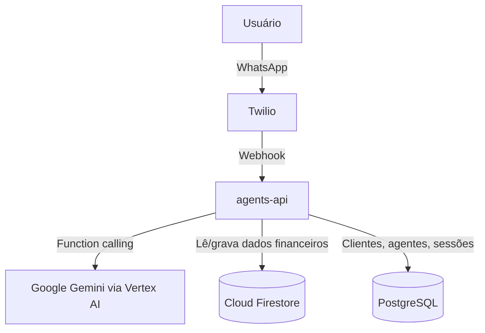

# Poupaí — Agents API

> Backend de agentes de IA do **Poupaí**, aplicativo de gestão financeira pessoal com assistente conversacional via WhatsApp.


## Sobre o projeto

API Node.js de **agentes financeiros com IA**, funcionando como backend inteligente do app [Poupaí](https://github.com/TCC-2026/poupai-app). Duas capacidades principais:

1. **Assistente via WhatsApp** — recebe mensagens (texto, áudio, imagem, PDF), processa com Gemini via Vertex AI, executa ações reais no Firestore do usuário através de *function calling*, e responde pelo WhatsApp.
2. **Insights financeiros** — endpoint que recebe o contexto financeiro do usuário e devolve um texto de educação financeira gerado por IA, com Google Search habilitado.

## Arquitetura



- **Camadas:** Controller → Service → Repository. Controllers validam e respondem; services orquestram IA e regras de negócio; repositories falam com PostgreSQL (via Prisma) ou Cloud Firestore (via `firebase-admin`).
- **Dois bancos, dois papéis:** o Firestore guarda os dados financeiros do usuário (o mesmo banco que o app Flutter usa); o PostgreSQL guarda só o domínio da própria API — clientes, agentes de IA, sessões e mensagens de conversa.
- **App e API se falam por dois canais:** o app Flutter lê/escreve direto no Firestore compartilhado, e chama esta API via HTTP para ações pontuais (insights, limpar sessão, excluir dados do assistente) — veja [`API.md`](./API.md).

### Stack

| Camada | Tecnologia |
|---|---|
| Runtime | Node.js (ESM) |
| Framework | Express 5 |
| Banco relacional | PostgreSQL via Prisma 7 |
| Banco de dados financeiro | Cloud Firestore (`firebase-admin`) |
| IA | Gemini via Vertex AI (`@google/genai`), retenção zero |
| WhatsApp | Twilio |
| Validação | Zod |
| Lint / Format | ESLint + Prettier |

## Funcionalidades

- Registrar receita/despesa por mensagem de texto, áudio ou foto de comprovante
- Corrigir um lançamento já existente
- Consultar saldo, extrato e limites de gasto pelo chat
- Definir limite de gasto por categoria e período
- Categorização automática de despesas via IA
- Cadeia de fallback entre modelos de IA (em erro 429/503, salta para o próximo agente configurado)
- Geração de insights educacionais sob demanda
- Limpeza do histórico de conversa e exclusão dos dados do assistente, sob demanda do app

## Pré-requisitos

- Node.js 20+
- PostgreSQL (local ou hospedado)
- Uma service account do Firebase com acesso ao Firestore do app Poupaí
- Uma service account do Google Cloud com acesso ao Vertex AI
- Uma conta Twilio com o canal WhatsApp configurado

## Como rodar localmente

```bash
git clone https://github.com/TCC-2026/agents-api.git
cd agents-api
npm install                  # roda "prisma generate" automaticamente (postinstall)
cp .env.example .env         # preencha com os valores reais
npx prisma migrate deploy    # aplica as migrations no seu Postgres
npm run dev                  # nodemon src/server.js
```

> O webhook da Twilio exige uma URL pública HTTPS mesmo em desenvolvimento local — use um túnel (ex.: `ngrok`) apontando para a porta local durante os testes.

## Variáveis de ambiente

Veja o [`.env.example`](./.env.example) para a lista completa e comentada. Resumo:

| Variável | Uso |
|---|---|
| `PORT` | Porta do servidor (default 3000) |
| `DATABASE_URL` | Conexão com o PostgreSQL |
| `ADMIN_PASS` | Bearer do endpoint de registro de cliente |
| `FIREBASE_CREDENTIALS` | JSON da service account do Firestore |
| `GCP_CREDENTIALS` / `GCP_LOCATION` | Credencial e região do Vertex AI |
| `PRIMARY_INSIGHT_MODEL` / `PRIMARY_ASSISTANT_MODEL` | `modelVersion` dos agentes ativos na tabela `agents` |
| `TWILIO_*` | Credenciais do canal WhatsApp |
| `LOGGING` | `disabled` silencia o logger |

## Estrutura de pastas

```
src/
├── server.js              # sobe o Express na PORT
├── app.js                 # middlewares base + rotas
├── routes/index.js        # rotas, cada uma com seu middleware de auth
├── controllers/           # ClientController, InsightController, SessionController, TwilioController
├── middlewares/           # adminAuth, apiKeyAuth, twilioAuth
├── services/              # AiService, AssistantService, InsightService, SessionService,
│                          # TwilioService, WhatsappService, ClientService
├── repositories/          # AgentRepository, ChatRepository, ClientRepository (Postgres)
│                          # FinanceRepository (Firestore)
├── tools/                 # function calling: 6 ferramentas + index
├── schemas/                # validação Zod
├── config/                 # firebase, gemini, prisma, twilio
└── utils/logger.js
```

## Endpoints

Referência completa, com exemplos de request/response e tratamento de erro: **[`API.md`](./API.md)**.

| Método/Rota | Auth | O que faz |
|---|---|---|
| `POST /api/v1/client` | `adminAuth` (Bearer `ADMIN_PASS`) | Registra um cliente e devolve uma API key |
| `POST /api/v1/agent/insight` | `apiKeyAuth` (Bearer API key do cliente) | Recebe `{ context }` e devolve `{ insight }` |
| `DELETE /api/v1/agent/session` | `apiKeyAuth` | Limpa o histórico de conversa do assistente para um `{ phone }` |
| `DELETE /api/v1/agent/account` | `apiKeyAuth` | Exclui a sessão e o histórico do assistente para um `{ phone }` |
| `POST /api/v1/agent/assistant/twilio` | `twilioAuth` (assinatura `X-Twilio-Signature`) | Webhook do WhatsApp |

## Scripts disponíveis

```bash
npm run dev        # nodemon, hot-reload
npm start          # node src/server.js
npm run lint        # eslint src/
npm run lint:fix    # eslint src/ --fix
npm run format       # prettier --write "src/**/*.js"
```

## Repositórios relacionados

- [`agents-api-v2`](https://github.com/TCC-2026/agents-api-v2) — próxima versão, em desenvolvimento (migração do canal WhatsApp de Twilio para a Meta Cloud API)
- [`poupai-app`](https://github.com/TCC-2026/poupai-app) — aplicativo Flutter (Android/iOS)

## Licença

ISC
